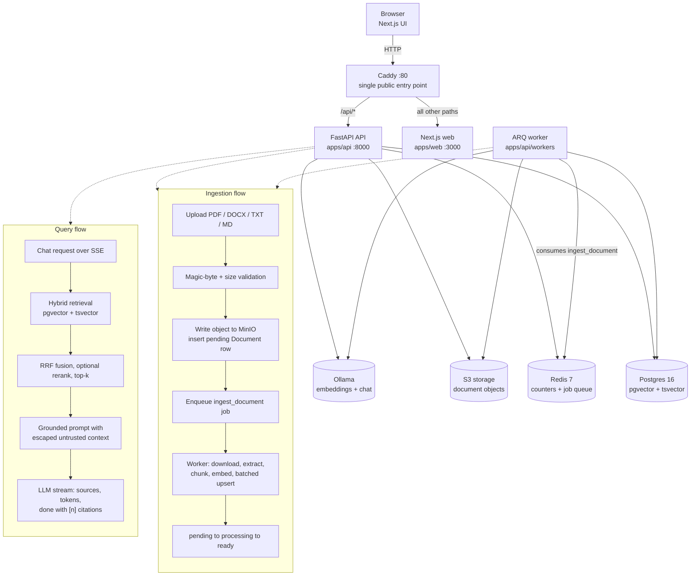
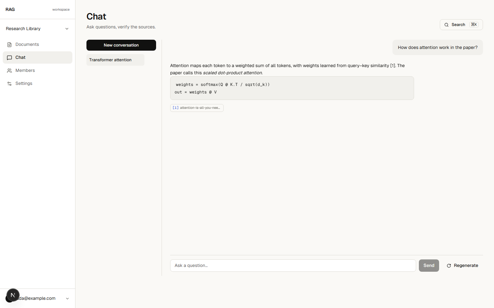
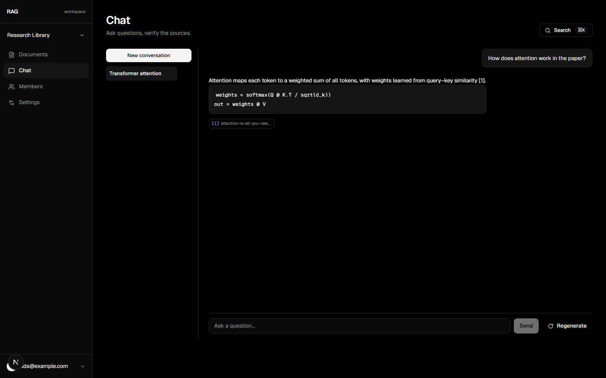
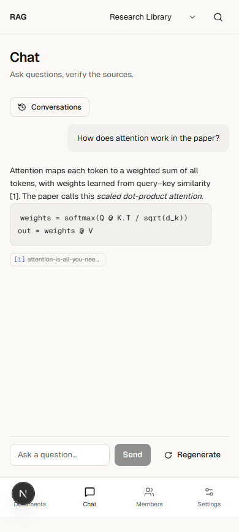
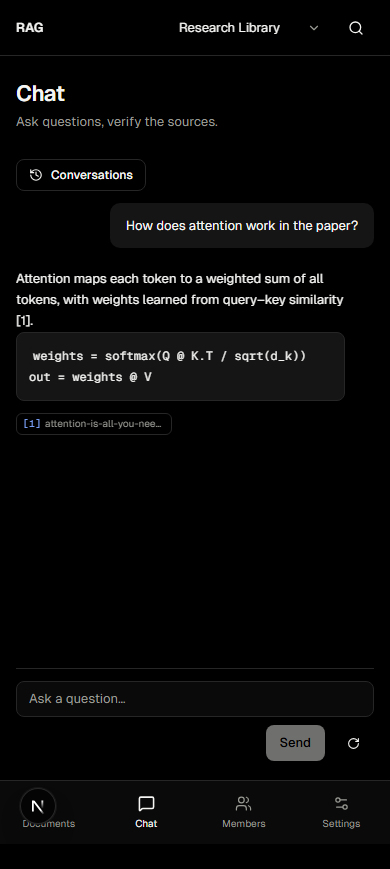

# RAG — local-first, multi-tenant question answering over your documents

This is a local-first, multi-tenant RAG (retrieval-augmented generation) app built with **FastAPI** and **Next.js**. It ingests PDF, DOCX, TXT and Markdown files into **pgvector + PostgreSQL full-text search**, answers questions with **grounded `[n]` citations**, and streams answers over **SSE** so the UI can render tokens as they arrive. Workspaces give each tenant isolated documents, conversations and settings; roles control who can upload, invite and administer. Bring-your-own-key (BYOK) providers let users supply their own OpenAI-compatible or Anthropic credentials (encrypted at rest), while the default stack runs entirely on local infrastructure with Ollama. Everything is orchestrated with Docker Compose, with Caddy as the single public entry point.

> Looking for the design rationale? Start with [docs/architecture.md](docs/architecture.md), the [retrieval quality numbers](docs/evaluation.md), the [decision log](docs/decisions.md), and [backup/restore](docs/backup.md).

## Quick start (under 10 minutes)

The production-style stack builds both images, starts Postgres/Redis/an S3-compatible object store/Ollama, runs migrations, starts the API, the ARQ worker, the web app and Caddy, and optionally seeds a demo workspace.

```bash
# 1. Configuration — generate .env with fresh secrets (no copy needed)
python scripts/generate_secrets.py

# 2. Build and start the whole stack (Caddy is the only published port)
docker compose -f docker-compose.prod.yml up -d --build

# 3. Seed the demo workspace/user (run once)
docker compose -f docker-compose.prod.yml --profile seed run --rm seed
# Alternative, with a local Python environment:
# python scripts/seed_demo.py

# 4. Open the app
# http://localhost
```

**Demo credentials:** `demo@example.com` / `DemoPassw0rd!`

The seed script is idempotent enough to re-run, but it is intended for a fresh local stack. Do not use these credentials in a shared environment; change `JWT_SECRET_KEY` and `LLM_MASTER_KEY` (the secret generator does this for you in `.env`) before exposing the app beyond localhost.

> The production stack includes a one-shot `ollama-pull` service that pulls both `OLLAMA_EMBEDDING_MODEL` and `OLLAMA_LLM_MODEL` before seeding. The UI is reachable as soon as the images are built; the first chat answer waits for the model download. On a slow connection, set `OLLAMA_LLM_MODEL` to a smaller model (for example `llama3.2:1b`) before starting. In the **development** stack, Ollama models are not pulled automatically; see [docs/docker-compose.md](docs/docker-compose.md) for the manual pull command and local port overrides (`embeddinggemma-2:440m` is the embedding model recorded in [docs/decisions.md](docs/decisions.md)).

## Repository layout

| Path | What lives there |
|---|---|
| `apps/api/` | FastAPI app (`main.py`), `api/v1/` endpoints, `services/`, `repositories/`, `models/`, `schemas/`, `providers/`, `workers/`, Alembic migrations, pytest suite |
| `apps/web/` | Next.js App Router app (`app/`), components, typed API client (`lib/api/`), Playwright specs (`e2e/`), UI captures (`/.impeccable/review/`) |
| `packages/` | Shared TypeScript config and lint packages |
| `evals/` | Retrieval harness, question set and raw results |
| `docs/` | This file's deeper reading: [architecture](docs/architecture.md), [evaluation](docs/evaluation.md), [decisions](docs/decisions.md), [backup](docs/backup.md), [compose reference](docs/docker-compose.md) |
| `scripts/` | `generate_secrets.py` (fills `.env`) and `seed_demo.py` (demo workspace/user) |
| `Caddyfile`, `docker-compose*.yml` | Public reverse proxy, dev/prod/test infrastructure |

## Architecture at a glance



In production, only Caddy is published; Postgres, Redis, MinIO, Ollama, the API and the web server communicate over the Compose network. Caddy handles `/health` locally, routes `/api/*` to FastAPI (SSE upgrades pass through) and sends all other paths — including invitation links — to Next.js. See [docs/architecture.md](docs/architecture.md#production-topology) for the topology and tradeoffs.

## What you get

- **Workspaces and roles** — create workspaces, invite by email with a shareable accept link, and enforce owner / admin / member permissions (last-owner protection included).
- **Document uploads** — drag-and-drop with progress; type is verified from magic bytes, size is streamed and limited, duplicates are detected per workspace, and re-index is available.
- **Grounded chat with citations** — hybrid retrieval (vector + keyword), reciprocal-rank fusion, optional reranking, numbered sources and `[n]` citation chips that open a snippet/page/heading panel.
- **Streaming UX** — SSE `sources` / `token` / `done` / `error` frames, stop and regenerate, conversation history, follow-up query rewriting, auto titles and reconnect handling.
- **Feedback and usage** — thumbs up/down with comments, derived query/token/storage totals, low-confidence and most-cited analytics, and an append-only audit log.
- **Rate limits and safety** — per-user chat/upload limits that fail closed, a fail-open login throttle, security headers, and prompt-injection defenses that treat document text as data.
- **Flexible providers** — built-in Ollama plus OpenAI-compatible and Anthropic adapters; users can add their own encrypted BYOK keys, and optional read-only host CLI providers are available for local development.

## An end-to-end tour

1. **Sign up or log in.** Register at `/register`; the access token stays in memory and the refresh token is an HttpOnly cookie. The dashboard redirects to `/dashboard`.
2. **Create a workspace.** The creator becomes its owner. Under **Settings → Members**, invite a teammate by email and share the generated accept link (there is no mail server).
3. **Add a provider (optional).** Under **Settings → Providers**, add an OpenAI-compatible or Anthropic BYOK key; it is encrypted at rest and its connection can be tested with a one-token request. The built-in Ollama provider needs no setup.
4. **Upload documents.** Go to **Documents** and drag in PDF, DOCX, TXT or MD files. The row starts `pending`, the ARQ worker moves it through `processing`, and the UI polls status/progress until it reaches `ready`. Re-index or delete at any time.
5. **Ask a question.** In **Chat**, start a conversation and watch SSE frames stream in. Citation chips open a side panel with the source snippet, document, page and heading path. Stop or regenerate a turn; follow-up questions are rewritten into standalone queries before retrieval.
6. **Inspect usage.** Workspace owners/admins can view analytics (most-asked questions, low-confidence answers, most-cited documents) and the append-only audit log. Members can leave thumbs up/down feedback on any assistant answer.

## Screenshots

Captures from the finished UI (light/dark, desktop/mobile), also used during visual review:


*Desktop, light theme — the editorial developer-console workspace.*


*Desktop, dark theme — pure black with a single cobalt signal color.*


*Mobile, light theme — sticky top bar and bottom navigation.*


*Mobile, dark theme — conversation sidebar becomes a bottom sheet.*

## Local development

The repo is a Turborepo: the web app is managed by pnpm, the API by uv. Install both toolchains, then run each side in its own terminal.

```bash
# One-time setup
cp .env.example .env                 # defaults are fine for local development
pnpm install
uv sync --all-groups

# Terminal 1 — frontend dev server (http://localhost:3000)
pnpm dev                            # or: pnpm --filter web dev

# Terminal 2 — API (http://localhost:8000, docs at /docs)
cd apps/api
uv run uvicorn main:app --reload --host 0.0.0.0 --port 8000

# Terminal 3 — ingestion worker (shares the API image/env)
cd apps/api
uv run arq workers.settings.WorkerSettings
```

Start the local infrastructure first with `docker compose up -d` (this loads `docker-compose.override.yml` automatically for API reload). Apply schema changes with `cd apps/api && uv run alembic upgrade head`. After changing any API route or schema, regenerate the typed web client with `pnpm --filter web api:types`. See [docs/docker-compose.md](docs/docker-compose.md) for infrastructure details and port overrides.

## Configuration reference

All settings are read from the environment (and the repo-root `.env`) by `apps/api/core/config.py`. The table below covers the important groups; every variable, including optional ones, is documented in [.env.example](.env.example), and the reasoning behind defaults is in [docs/architecture.md](docs/architecture.md).

| Area | Variables (see `.env.example`) | Notes / defaults |
|---|---|---|
| Database | `POSTGRES_USER`, `POSTGRES_PASSWORD`, `POSTGRES_DB`, `POSTGRES_HOST`, `POSTGRES_PORT`, `DATABASE_URL` | Compose uses service name `postgres` internally; `DATABASE_URL` overrides the assembled URL. `pgvector/pgvector:pg16`. |
| Auth / JWT | `JWT_SECRET_KEY`, `JWT_ALGORITHM`, `ACCESS_TOKEN_TTL_MINUTES`, `REFRESH_TOKEN_TTL_DAYS` | Override the dev secret in any shared environment. Access 15 min, refresh 7 days by default. |
| Refresh cookie | `REFRESH_COOKIE_NAME`, `REFRESH_COOKIE_PATH`, `REFRESH_COOKIE_SAMESITE`, `REFRESH_COOKIE_SECURE` | HttpOnly is always on; `Secure` defaults on and is only disabled for plain-HTTP local dev. |
| Login throttle | `LOGIN_RATE_LIMIT_MAX_ATTEMPTS`, `LOGIN_RATE_LIMIT_WINDOW_SECONDS`, `TRUST_PROXY_HEADERS` | 5 attempts / 300 s per IP and per email; trust `X-Forwarded-For` only behind a trusted proxy. |
| BYOK encryption | `LLM_MASTER_KEY`, `LOCAL_MODE_ENABLED` | Fernet master key for provider keys; generate with `Fernet.generate_key()`. Missing/invalid key → 503. Private base URLs blocked unless local mode is on. |
| Ollama / embeddings | `OLLAMA_BASE_URL`, `OLLAMA_PORT`, `OLLAMA_EMBEDDING_MODEL`, `EMBEDDING_DIM`, `EMBEDDING_BATCH_SIZE`, `EMBEDDING_TIMEOUT_SECONDS`, `EMBEDDING_MAX_RETRIES`, `EMBEDDING_NORMALIZE` | Embedding model `embeddinggemma-2:440m`, 768-dim, L2-normalized, batches of 32. |
| Chat providers | `LLM_PROVIDER`, `OLLAMA_LLM_MODEL`, `OPENAI_*`, `ANTHROPIC_*`, `LLM_TIMEOUT_SECONDS`, `CHAT_DEFAULT_PROVIDER` | Registry supports Ollama, OpenAI-compatible and Anthropic adapters. |
| Retrieval | `RETRIEVAL_CANDIDATE_K`, `RETRIEVAL_TOP_K`, `RETRIEVAL_SCORE_THRESHOLD`, `RRF_K`, `RERANK_ENABLED`, `RERANK_*` | 20 candidates / 5 final, RRF k=60, threshold 0.15; reranker off by default. See the [evaluation](docs/evaluation.md) before tuning. |
| Prompting | `PROMPT_CONTEXT_TOKEN_BUDGET`, `CHAT_MAX_TOKENS`, `CHAT_HISTORY_TOKEN_BUDGET`, `CHAT_REWRITE_ENABLED`, `CHAT_TITLE_ENABLED` | 2000 / 512 / 1200 tokens; history rewriting and auto titles on by default. |
| Redis | `REDIS_HOST`, `REDIS_PORT` | Shared by login/login throttling, user rate limits and the ARQ queue. |
| Object storage | `MINIO_ROOT_USER`, `MINIO_ROOT_PASSWORD`, `MINIO_HOST`, `MINIO_PORT`, `MINIO_BUCKET`, `MINIO_SECURE` | The app uses the MinIO SDK against any S3 endpoint. The prod compose runs LocalStack on port 4566; a one-shot init container creates the bucket. Keys are `<workspace_id>/<uuid>`. |
| Uploads / worker | `MAX_UPLOAD_SIZE_BYTES`, `PRESIGNED_URL_TTL_SECONDS`, `INGEST_MAX_TRIES`, `INGEST_JOB_TIMEOUT_SECONDS`, `CHUNK_*` | 25 MB limit, 3 tries with backoff, ~500-token chunks / 50 overlap, strategy `auto`. |
| User rate limits | `CHAT_RATE_LIMIT_MAX`, `CHAT_RATE_LIMIT_WINDOW_SECONDS`, `UPLOAD_RATE_LIMIT_MAX`, `UPLOAD_RATE_LIMIT_WINDOW_SECONDS` | Metered actions fail closed on Redis outage; see [architecture](docs/architecture.md#rate-limiting). |
| Security headers / CORS | `CORS_ORIGINS`, `CORS_ALLOW_CREDENTIALS` | `SecurityHeadersMiddleware` sets nosniff, frame deny, referrer policy, CSP and HSTS; headers are code-configured, CORS is env-configured. |
| CLI mode (experimental) | `ENABLE_CLI_PROVIDERS`, `CLI_TIMEOUT_SECONDS`, `CLI_MAX_CONCURRENT` | See the warning below — off by default and not available in Docker. |

## CLI mode warning

> [!WARNING]
> **Local CLI providers (experimental, disabled by default)**
>
> The optional `cli-codex`, `cli-opencode` and `cli-claude` providers shell out to
> CLIs installed **on the host**. They are disabled unless `ENABLE_CLI_PROVIDERS=true`.
>
> > **Warning:** these providers can spend your CLI account's quota and are only
> > safe when the CLI is invoked read-only with all tools denied. The backend runs
> > each CLI in a fresh temp directory with no shell, no auto-approve flags, a
> > hard timeout and a concurrency limit. Do not enable them on an untrusted
> > multi-tenant host. Uploaded document text is treated as untrusted data, not
> > instructions.
>
> **Docker:** CLI providers do **not** run inside the API container because the
> container has neither the host's CLI binaries nor its login credentials. Run the
> backend on the host for this feature, or add a host bridge service that the
> container calls through `host.docker.internal` (not included in this phase).
> The API refuses to construct a CLI provider when it detects it is in a
> container. Check availability with `GET /api/v1/providers/cli/status`.

## Security notes

- **Fail-closed metered limits:** chat and upload counters return 503 when Redis is unavailable, so work cannot run unbounded during an outage.
- **Fail-open login throttle:** a Redis outage logs a warning and allows login attempts rather than locking everyone out; the limit is per client IP and hashed email.
- **Token handling:** the access token lives only in module memory in the browser (never `localStorage`); the refresh token is an HttpOnly, Secure, SameSite cookie scoped to `/api/v1/auth` and is never returned in a response body.
- **Validation:** Pydantic/FastAPI validation strips submitted values from 422 details so passwords and secrets are never echoed back; password verification runs against a dummy hash for unknown emails.
- **BYOK safety:** keys are Fernet-encrypted with `LLM_MASTER_KEY` (only ciphertext and last four characters are stored), and a `core/net.py` SSRF guard rejects private/loopback/link-local base URLs unless `LOCAL_MODE_ENABLED=true`.
- **Headers and isolation:** `SecurityHeadersMiddleware` applies nosniff, DENY frame options, no-referrer, a restrictive CSP, cross-origin policies and HSTS on HTTPS; every workspace-scoped query is filtered by `workspace_id`.
- **Untrusted document text:** context is escaped inside `<context>/<source>` blocks, the system prompt treats it strictly as data, and CLI providers run with no tools and no writable sandbox.
- **Append-only audit log:** sensitive actions are recorded with `actor_email` and nullable `user_id`/`workspace_id` foreign keys (`SET NULL`), so history survives account or workspace deletion in redacted form.

## Documentation

- [Architecture and tradeoffs](docs/architecture.md)
- [Retrieval evaluation results](docs/evaluation.md)
- [Development decisions and history](docs/decisions.md)
- [Backup and restore](docs/backup.md)
- [Local Docker Compose reference](docs/docker-compose.md)

## Known limitations (v1)

The [decision log](docs/decisions.md) and [architecture](docs/architecture.md) track these explicitly:

- No mail transport: password reset and email verification are not implemented; invitations produce a shareable accept link instead.
- Stop/regenerate uses an in-process registry, so it is correct with one API process only.
- The optional reranker is a TEI-compatible hook; a real cross-encoder has not been benchmarked.
- The relevance threshold is currently miscalibrated after RRF fusion, so low-confidence abstention does not fire (see [evaluation](docs/evaluation.md)).
- Citations are parsed from `[n]` markers in answer text rather than stored in a normalized table.
- Embedding model selection is global, not per workspace; there is no DNS-rebinding guard for BYOK URLs and no orphan-object reconciliation sweep yet.

## Verification

```bash
# Web: lint, type-check and production build
pnpm lint
pnpm check-types
pnpm build

# API: full Python test suite (in-memory SQLite + fake Redis; PG tests skip without Docker)
uv run pytest -q

# Retrieval quality harness (relative comparisons; see docs/evaluation.md)
python evals/evaluate.py
# or: pnpm eval
```

## Troubleshooting

- **Port 5432 already in use:** set `POSTGRES_PORT=5433` and `POSTGRES_HOST=127.0.0.1` in `.env` and restart the dev stack; see [docs/docker-compose.md](docs/docker-compose.md).
- **Chat or embeddings fail in the dev stack:** the Ollama model may not have been pulled. Run `docker compose exec ollama ollama pull embeddinggemma-2:440m` (and pull the chat model configured in `OLLAMA_LLM_MODEL`).
- **Login works but the session drops over plain HTTP:** `REFRESH_COOKIE_SECURE` defaults to `false` in the production compose for local HTTP; set it to `true` only after putting the app behind HTTPS.
- **A CLI provider is missing from the picker:** CLI providers require host binaries and are disabled in Docker by design. Check `GET /api/v1/providers/cli/status` and review the [CLI mode warning](#cli-mode-warning).
- **Invitations have no email delivery:** there is no mail transport; the accept token/link is returned in the API response and rendered by the UI.
- **Answers say "I don't know" too often or never:** the relevance threshold currently has a known calibration problem — see [docs/evaluation.md](docs/evaluation.md#findings) and [docs/architecture.md](docs/architecture.md#hybrid-retrieval-rrf-and-the-abstention-problem).
